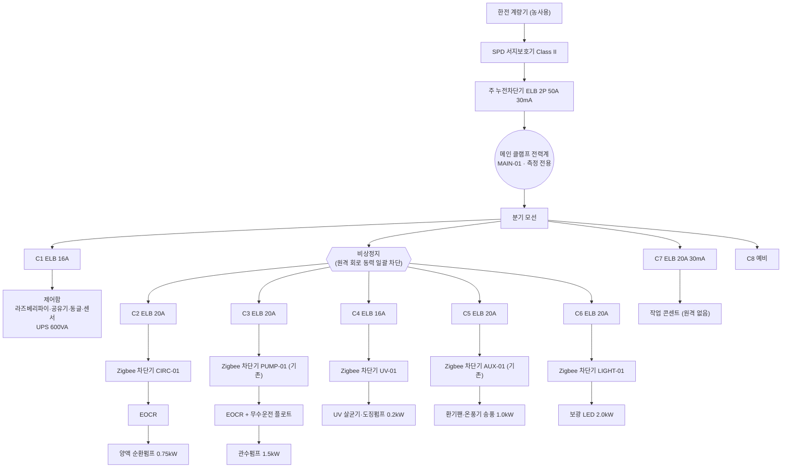

# Farm365 메인 분전반 설계서 — 전력 계측·원격 개폐 포함

- 작성일: 2026-10-18 (같은 날 개정: 단상 확정, 부하 선택식, 전력 표시·과열 알림)
- 대상: Farm365(스마트팜)·Shrimp365(양식장) 장비 공통 — 라즈베리파이 키오스크 1대 + 분전반 1면
- 관련: `openfield/configs/devices.yaml`(지그비 장치 매핑), `openfield/docs/센서수집-기술해설.md`(적산값 처리),
  `openfield/docs/STA-시험절차서.md` T-07(제어응답), `raspberry-pi/INSTALL.md`

> **이 문서는 기본 설계(구성·보호 원칙·계측 연동)다.** 차단기 정격·전선 굵기·접지 저항값의
> 최종 산정과 시공·검사는 **전기공사업 등록업체(유자격 기술자)** 가 KEC(한국전기설비규정)에 따라
> 확정한다. 아래 수치는 가정한 부하에 대한 **시작값**이며, 실제 명판·배선 거리로 다시 계산한다.

---

## 1. 전제와 가정

| 항목 | 이 설계의 가정 | 바뀌면 |
|---|---|---|
| 수전 | **단상 2선 220V 60Hz (확정)**, 한전 농사용 전력, 계약 10kW(가정) | — |
| 부하 | **현장에서 고른다.** 어떤 기기가 붙을지 미리 정하지 않는다 — 4-1 카탈로그와 4-2 크기별 선정표에서 회로마다 고른다. 4장 표는 한 예시 | 회로를 고르는 대로 4장 예시 대신 실제 표를 채운다 |
| 계측·개폐 | Tuya **Zigbee 스마트 차단기 1P 63A(전력계측형)** — 이미 2대 운용 중(PUMP-01·AUX-01) | — |
| 수집 | SONOFF 동글 → Zigbee2MQTT → `zigbee_bridge.py` (기존 경로 그대로) | — |
| 설치 장소 | 비닐하우스 내부, 다습·결로·분진 | 옥외면 IP 등급·자외선 내후성 상향 |

## 2. 설계 원칙 (안전이 먼저)

1. **제어기는 자기 전원을 끌 수 없다.** 라즈베리파이·공유기·지그비 동글·센서·UPS 가 있는 **제어함 회로에는
   원격 개폐 장치를 달지 않는다.** 자동화가 이 회로를 끄면 원격으로는 영영 되살릴 수 없다.
2. **보호는 인증된 차단기가 한다.** 스마트 차단기는 *개폐·계측용*으로만 본다. 과전류·누전 보호는 그 앞단의
   KC 인증 누전차단기(ELB)·배선용차단기(MCB)가 맡는다. 스마트 차단기의 보호 기능에 기대지 않는다.
3. **습한 곳은 전 분기 고감도 누전차단(30 mA, 0.03 s).** 양액·관수·콘센트처럼 물과 닿는 회로는 예외 없이.
4. **하드웨어 인터록은 소프트웨어보다 앞선다.** 펌프 무수(空)운전 방지 플로트, 모터 과부하(EOCR)는 배선으로 건다.
   Farm365 가 꺼져도, 지그비가 끊겨도 펌프가 스스로 상하지 않아야 한다.
5. **현장 수동 조작이 늘 가능해야 한다.** 원격 회로마다 수동 개폐(스마트 차단기 본체 레버, 또는 수동/자동
   절환 스위치)가 있다. 네트워크가 죽은 날에도 농가가 손으로 펌프를 돌릴 수 있어야 한다.
6. **정전 뒤 돌아올 상태를 회로마다 정해 둔다**(5-4). 기본값에 맡기면 관수펌프가 정전 복구와 함께 혼자 돈다.
7. **비상정지 1개**: 함체 문 앞 버섯형 비상정지 → 원격 회로 전체의 동력만 끊는다(제어함 회로 제외).

## 3. 단선 결선도



- C1(제어함)과 C7(콘센트)은 **비상정지·원격 개폐 밖**에 둔다(원칙 1·7).
- 메인 클램프 전력계는 **개폐 기능이 없는** 측정 전용이다. 농장 전체 사용량과 "어느 회로에도 안 잡힌 전력"
  (= 메인 − 분기 합)을 보기 위해 둔다.

## 4. 회로·부하표 — 예시 (실제는 4-1·4-2 로 고른다)

단상 220V, 역률 0.85 가정. 전류 = kW × 1000 / (220 × 역률). 차단기는 연속부하 125% 이상, 전선은 차단기 정격 이상.

| 회로 | 부하 (가정) | kW | 전류(A) | 분기 차단기 | 전선(최소) | 원격 개폐·계측 | 정전 복귀 |
|---|---|---:|---:|---|---|---|---|
| C1 | 제어함(라즈베리파이·공유기·동글·센서) + UPS 600VA | 0.3 | 1.6 | ELB 2P 16A 30mA | 2.5㎟ | **없음**(원칙 1) | 상시 |
| C2 | 양액 순환펌프 | 0.75 | 4.0 | ELB 2P 20A 30mA | 2.5㎟ | CIRC-01 | **ON** (순환이 멈추면 뿌리 산소가 끊긴다) |
| C3 | 관수펌프 (노지 점적) | 1.5 | 8.0 | ELB 2P 20A 30mA | 2.5㎟ | PUMP-01 (기존) | **OFF** (넘침·과관수 방지) |
| C4 | UV 살균기 + 양액 도징펌프(A·B) | 0.2 | 1.1 | ELB 2P 16A 30mA | 2.5㎟ | UV-01 | **ON** |
| C5 | 환기팬 2대 + 온풍기 송풍·버너 | 1.0 | 5.3 | ELB 2P 20A 30mA | 2.5㎟ | AUX-01 (기존) | **이전 상태** |
| C6 | 보광 LED | 2.0 | 10.7 | ELB 2P 20A 30mA | 4㎟ | LIGHT-01 | **OFF** (Farm365 가 일정대로 켠다) |
| C7 | 작업 콘센트 | 2.0 | 10.7 | ELB 2P 20A 30mA | 4㎟ | 없음 | 상시 |
| C8 | 예비 (향후 냉방·제습기) | — | — | 공간만 | — | — | — |
| **합계** | | **7.75** | **41.4** | | | | |

- **수용률** 0.8 가정 → 최대 수요 약 6.2 kW · 33 A. **주차단기 ELB 2P 50A**, 인입 간선 **10㎟ 이상**(거리 길면 16㎟).
- 전선 굵기는 배선 방법(전선관·트레이)·거리(전압강하 3% 이내)·주위 온도로 **시공자가 상향 조정**한다.
- 2.2 kW 를 넘는 모터나 3상 부하는 5-3 방식으로 바꾼다.

## 4-1. 부하 종류 카탈로그 — 회로마다 하나를 고른다

장비 화면 **[설정] → [전력 회로]** 에서 같은 목록으로 회로 종류를 고르면, 장비 화면·웹 대시보드의
전력 칸 이름과 아이콘이 그대로 따라간다(양식장·스마트팜 공통). 목록에 없으면 **기타**.

| 종류(설정 값) | 화면 이름 | 주로 쓰는 곳 | 흔한 크기 | 정전 복귀 권장 |
|---|---|---|---|---|
| `main` | 전체(인입) | 공통 — 메인 클램프 전력계 | — | (측정 전용) |
| `aerator` | 산소공급기·브로워 | 양식장 | 0.4~2.2 kW 모터 | **ON** — 멈추면 폐사 |
| `circulation_pump` | 순환펌프 | 양식장·스마트팜 | 0.2~1.5 kW 모터 | **ON** |
| `irrigation_pump` | 관수펌프 | 스마트팜·노지 | 0.4~2.2 kW 모터 | OFF |
| `heater` | 히터·난방 | 양식장(수온)·스마트팜 | 1~3 kW 저항 | 이전 상태 |
| `ventilation` | 환기팬 | 스마트팜 | 0.1~0.75 kW 모터 | 이전 상태 |
| `cooling` | 냉방·제습 | 공통 | 0.7~2.5 kW 압축기 | OFF (재기동 보호) |
| `lighting` | 조명·보광 | 스마트팜 | 0.2~3 kW | OFF |
| `uv` | UV 살균기 | 공통 | 0.05~0.3 kW | ON |
| `dosing` | 양액 도징펌프 | 스마트팜 | ≤ 0.1 kW | OFF |
| `feeder` | 자동급이기 | 양식장 | ≤ 0.3 kW | OFF |
| `other` | 기타 | — | — | 현장 판단 |

- 처음 들어온 차단기는 센서 이름 앞부분으로 종류를 짐작한다(`PUMP-`→관수펌프, `AUX-`→환기팬, `CIRC-`→순환펌프,
  `UV-`, `LIGHT-`, `MAIN-`, `AIR-`→산소공급기, `HEAT-`→히터). 틀리면 화면에서 바꾸면 된다.

## 4-2. 크기별 선정표 — 단상 220V

회로의 부하 크기만 알면 아래 한 줄로 분기 차단기·전선·계측 방식이 정해진다(역률 0.85, 연속부하 125%).
최종 굵기는 거리·포설 방법으로 시공자가 상향한다.

| 부하 크기 | 전류 | 분기 차단기 | 전선(최소) | 개폐·계측 | 추가 보호 |
|---|---:|---|---|---|---|
| ≤ 0.5 kW | ≤ 2.7 A | ELB 2P 16A 30mA | 2.5㎟ | Zigbee 차단기 직결 | 모터면 EOCR |
| 0.5 ~ 1.5 kW | ≤ 8 A | ELB 2P 20A 30mA | 2.5㎟ | Zigbee 차단기 직결 | 모터면 EOCR, 펌프면 무수운전 플로트 |
| 1.5 ~ 2.2 kW **모터** | ≤ 11.8 A | ELB 2P 20A 30mA | 4㎟ | **MC 방식(5-3)** + 클램프 전력계 | EOCR — 기동전류가 스마트 차단기 접점을 상하게 한다 |
| 1.5 ~ 3 kW **저항**(히터·조명) | ≤ 16 A | ELB 2P 20A 30mA | 4㎟ | Zigbee 차단기 직결 | 히터는 과열 방지 서모스탯 |
| 3 ~ 5 kW | ≤ 27 A | ELB 2P 30A 30mA | 6㎟ | MC 방식 + 클램프 전력계 | — |
| 5 kW 초과 | — | 단상 분전반 용량 재검토 | — | — | 계약전력·인입 간선 재산정 |

## 4-3. 현장 선택 절차

1. 붙일 기기의 명판(kW·종류)을 적는다.
2. 4-2 표에서 크기 줄을 골라 분기 차단기·전선·계측 방식을 정한다(시공자).
3. Zigbee 차단기(또는 클램프 전력계)를 페어링하고 `devices.yaml` 에 명시 매핑을 적는다(6장).
4. 장비 화면 **[설정] → [전력 회로]** 에서 4-1 종류를 고른다 → 장비 화면·웹에 이름이 붙는다.
5. Z2M 에서 정전 복귀(`power_on_behavior`)를 4-1 권장대로 맞춘다.

## 4-4. 차단기 과열 알림

Zigbee 차단기는 자기 본체 온도(`device_temperature`)를 보낸다. 접점이 닳거나 단자가 풀리면 먼저 뜨거워지므로
**화재 전조**로 본다.

| 본체 온도 | 장비 화면 | 웹·휴대폰 |
|---|---|---|
| 65 ℃ 이상 | 해당 회로 주황, 위쪽에 경고 띠 | **주의** 알림 + 푸시 |
| 80 ℃ 이상 | 빨강 경고 띠 | **위험** 알림 + 푸시(주의→위험으로 오를 때도) |
| 60 ℃ 아래로 내려오면 | 정상 | 알림 자동 해제 |

비닐하우스 한여름 함 내부는 50 ℃ 를 넘을 수 있어 65 ℃ 를 첫 단계로 잡았다. 알림이 잦으면 함 환기부터 본다.

## 5. 계측·개폐 구성

### 5-1 Zigbee 스마트 차단기 — 소형 부하 (≤ 1.5 kW 단상 모터, 조명, 저항부하)
`분기 ELB → Zigbee 차단기 → (모터면 EOCR) → 부하` 로 **직렬**로 넣는다.

- 보내는 값: `state`(통전 여부), `current`(A), `power`(W), `voltage`(V), `energy`(적산 kWh), `device_temperature`.
- Farm365 수집기가 `energy` 를 **구간 차분**으로 바꿔 적는다(`ofdf.data.counter`). 30초 가동도 놓치지 않는다.
- `device_temperature` 는 진단값으로 따로 남는다 — **차단기 과열은 화재 전조**라 알림 후보다.
- 정격 63A 표기여도 **모터 기동전류**를 고려해 연속 16A 이하 부하에만 직결한다.

### 5-2 메인 계측 — Zigbee 클램프형 전력계 (측정 전용)
- 주차단기 2차측 활선에 CT 를 물린다. 개폐 기능이 없는 제품이라 **원격으로 농장 전체가 꺼질 일이 없다.**
- 용도: 일·월 사용량(전기요금), 분기 합과의 차이(누락 회로·누설 의심), 기본요금 산정용 최대수요 확인.

### 5-3 대형·3상 모터 — 전자접촉기(MC) 방식
`분기 MCCB → MC(전자접촉기) → EOCR → 모터`, Zigbee 차단기는 **MC 코일 회로**를 개폐한다.

- 이 경우 Zigbee 차단기의 전력값은 코일 전류(수 W)라 의미가 없다 → 모터 선로에 **Zigbee 클램프 전력계**를
  하나 더 물려 계측한다(되읽기 = 전류가 떴는가).
- 코일 회로에 **수동/자동 절환 스위치**를 둔다(원칙 5).

### 5-4 정전 복귀 상태 — 반드시 설정
Tuya 차단기는 Zigbee2MQTT 에서 `power_on_behavior`(off / on / previous)를 장치마다 설정한다.
**Farm365 수집기는 이 값을 기록하지 않으므로**(진단값 목록에서 제외) 시운전 때 Z2M 웹UI 에서 4장 표의
"정전 복귀" 열대로 직접 맞추고 사진으로 남긴다.

## 6. Farm365 데이터 연동

새 장치는 **반드시 `map:` 을 적는다.** 매핑을 안 적은 계측 장치는 기본 매핑에 따라
`pump_current`·`pump_power`·`pump_energy` 로 들어가 **관수펌프 값에 섞인다**(`ofdf.data.zigbee` 기본 맵).

`openfield/configs/devices.yaml` 의 `kinds:` 에 더할 것(설치하는 장치만):

```yaml
  # 양액 순환펌프 회로 — 정전 복귀 ON
  breaker-circ:
    note: 220V 분전반 C2 · 양액 순환펌프
    map:
      state: circ_state
      current: circ_current
      power: circ_power
      voltage: line_voltage        # 같은 분전반 선간전압 — 공용
      energy: circ_energy
      temperature: ""
    sends: [linkquality]

  breaker-uv:                      # C4 UV 살균기·도징펌프
    map: {state: uv_state, current: uv_current, power: uv_power,
          voltage: line_voltage, energy: uv_energy, temperature: ""}
    sends: [linkquality]

  breaker-light:                   # C6 보광 LED
    map: {state: light_state, current: light_current, power: light_power,
          voltage: line_voltage, energy: light_energy, temperature: ""}
    sends: [linkquality]

  # 메인 클램프 전력계 — 측정 전용(state 없음)
  meter-main:
    note: 주차단기 2차측 CT
    map: {current: main_current, power: main_power, voltage: line_voltage,
          energy: main_energy, temperature: ""}
    sends: [linkquality]
```

`devices:` 에는:

```yaml
  breaker-circ-01:  {kind: breaker-circ,  zone: facility, sensor_id: CIRC-01,  note: 양액 순환펌프}
  breaker-uv-01:    {kind: breaker-uv,    zone: facility, sensor_id: UV-01,    note: UV 살균기·도징}
  breaker-light-01: {kind: breaker-light, zone: facility, sensor_id: LIGHT-01, note: 보광 LED}
  meter-main-01:    {kind: meter-main,    zone: facility, sensor_id: MAIN-01,  note: 메인 분전반 인입}
```

- 이름(키)은 Z2M 웹UI 에서 페어링 후 붙인 friendly_name 과 **글자까지 같아야** 한다.
- **지금은 수집·기록까지만 된다.** 장비 화면·웹 대시보드에 전력 칸은 아직 없다(후속 작업, 9장).

## 7. 함체·배치

| 항목 | 사양 | 이유 |
|---|---|---|
| 분전함 | **비금속(폴리카보네이트) IP65**, 내부 DIN 레일 2단, 투명 점검창 | **금속 함체는 2.4 GHz 지그비 전파를 막는다.** 금속이어야 하면 지그비 라우터를 함 밖에 둔다 |
| 제어함 | 기존 사양 IP65 600×500×250, 환기팬·결로방지 히터(서모스탯), UPS 600VA | 라즈베리파이 과열·결로 |
| 거리 | 분전함 ↔ 제어함(동글) 5 m 이내, 사이에 금속 칸막이 없게 | 지그비 링크 품질. Farm365 가 `linkquality` 를 남기므로 시운전 때 **80 이상** 확인 |
| 접지 | 외함·DIN 레일·금속 프레임·하우스 골조 접지, 보호도체 PE 단자대 | KEC 접지시스템 |
| 표시 | 회로 번호(C1~C8)·용도·정전 복귀 설정을 문 안쪽에 부착 | 현장 조작 실수 방지 |
| 결로 | 하단 케이블 그랜드, 배수 구멍, 함 내부 히터 | 비닐하우스 야간 결로 |

## 8. 자재표 (가정 부하 기준)

| 품목 | 규격 | 수량 | 비고 |
|---|---|---:|---|
| 서지보호기(SPD) | 단상 Class II, 20 kA | 1 | 낙뢰 — 비닐하우스·노지 |
| 주 누전차단기 | ELB 2P 50A 30mA | 1 | KC 인증 |
| 분기 누전차단기 | ELB 2P 20A 30mA | 5 | C2·C3·C5·C6·C7 |
| 분기 누전차단기 | ELB 2P 16A 30mA | 2 | C1·C4 |
| Zigbee 스마트 차단기 | 1P 63A 전력계측형 (Z2M 지원) | 3 (+기존 2) | CIRC-01·UV-01·LIGHT-01 신규 |
| Zigbee 클램프 전력계 | 측정 전용, CT 50A 이상 (Z2M 지원) | 1 | MAIN-01 |
| EOCR(전자식 과부하계전기) | 단상, 펌프 정격전류 범위 | 2 | C2·C3 |
| 무수운전 방지 플로트 스위치 | 저수조용 | 1 | C3 관수펌프 |
| 비상정지 스위치 | 버섯형 1b, 해제 키 | 1 | + 원격 회로 동력 차단용 MC 1 |
| 분전함 | 폴리카보네이트 IP65, 투명창 | 1 | |
| 단자대·PE 단자대·DIN 레일·덕트 | — | 일식 | |
| 전선 | HFIX 2.5㎟/4㎟/10㎟, 접지선 | 일식 | 거리 산정 후 |

## 9. 시공·시운전 체크리스트

1. [ ] 부하 명판 확인 → 4장 표 갱신 → 차단기·전선 재산정(시공자)
2. [ ] 한전 계약전력·농사용 전력 종별 확인
3. [ ] 절연저항·접지저항 측정, 누전차단기 시험 버튼 동작(전 분기)
4. [ ] 비상정지: 원격 회로만 끊기고 **C1 제어함·C7 콘센트는 살아 있는지**
5. [ ] Z2M 페어링 → friendly_name 을 6장 이름으로 → `devices.yaml` 반영 → `python -m ofdf.cli sensors` 로 확인
6. [ ] 각 차단기 `power_on_behavior` 를 4장 표대로 설정, 메인 차단기 내렸다 올려 실제 복귀 상태 확인
7. [ ] 회로마다 원격 ON/OFF → 수집 파일에 `*_state`·`*_current` 가 바뀌는지(T-07 제어응답 절차와 같다)
8. [ ] 메인 전력 ≈ 분기 합 + 제어함·콘센트(±10%) — 크게 어긋나면 누락 회로·결선 확인
9. [ ] 관수펌프 저수조를 비우고 플로트가 펌프를 세우는지(무수운전 방지)
10. [ ] 모든 지그비 장치 `linkquality` 80 이상

## 10. 결정이 필요한 것

| 질문 | 기본값(이 설계) |
|---|---|
| 수전이 단상인가 3상인가 | **단상 220V (확정)** |
| 실제 부하 목록·정격 | **현장에서 4-1·4-2 로 고른다** |
| 전력값을 장비 화면·웹에 보일 것인가 | **예 (2026-10-18 결정)** — 양식장·스마트팜 공통. 장비 화면 전력 칩·회로판, 웹 "전력" 카드 |
| 차단기 과열(`device_temperature`)을 알림으로 보낼 것인가 | **예 (2026-10-18 결정)** — 4-4 기준 |
| 화면·웹에서 회로를 켜고 끌 것인가 | **예** — 장비 화면(PR #69), 웹 전력 카드(2026-10-25 결정). 웹 명령은 명령함(`power_commands`)에 넣고 장비가 15초마다 가져가 장비 화면과 같은 입구로 실행한다. 인입 회로 금지·과열 중 켜기 금지·산소 부족 강제 켜기는 장비가 지킨다. 2분 넘게 안 가져간 명령은 버린다. 농장 주인만, `[power] remote = false` 로 끈다 |
| 메인 계측을 Modbus 전력량계(RS-485)로 할 것인가 | 지금은 Zigbee 클램프. Modbus 는 `modbus_bridge.py` 에 계량기 지원을 새로 넣어야 한다 |
