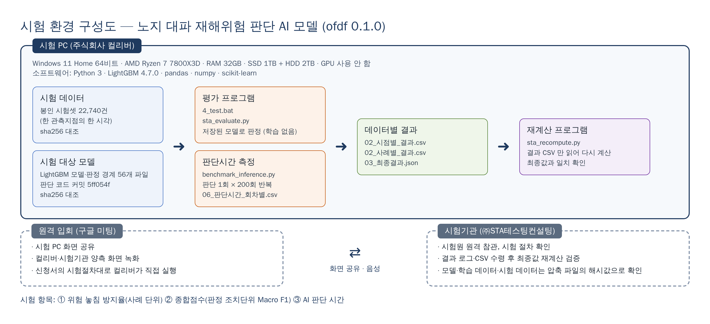
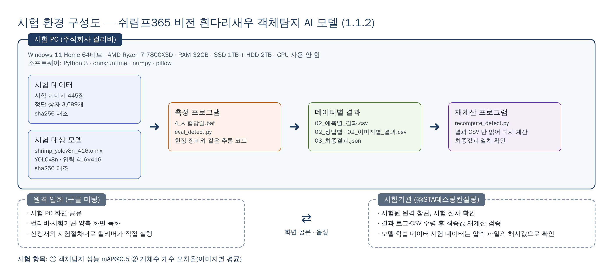
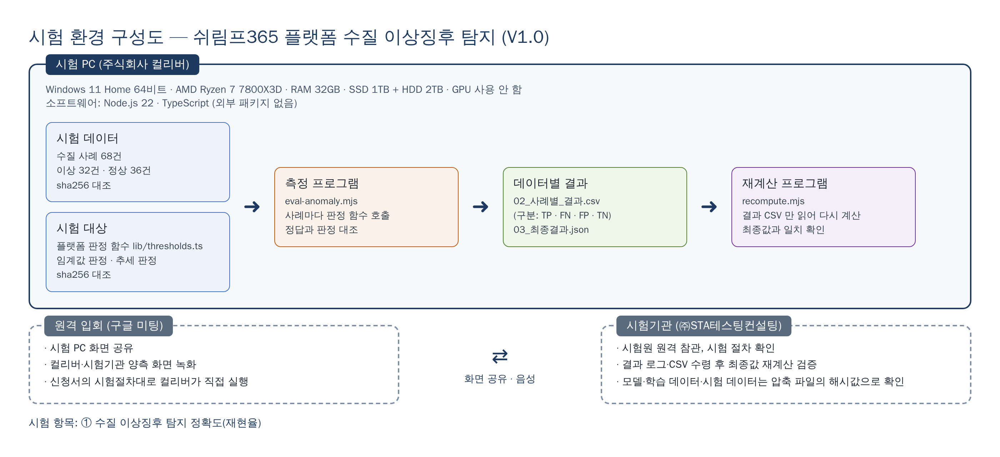

# STA 회신 — 시험 환경 구성도와 제품 개발 환경

2026-11-19 · 주식회사 컬리버 · 시험 3건(① AI 노지 ② 블루스타트업 ③ AI·데이터)

`[확인]` 은 시험 PC에서 명령으로 읽어 적을 자리다. 명령은 건마다 표 아래에 있다. 버전은 세 자리까지 적는다.

---

## 1. 시험 환경 구성도

세 건 모두 같은 틀이다. 컬리버의 시험 PC에서 시험 데이터와 시험 대상을 해시로 대조한 뒤 측정 프로그램을 실행하고, 데이터별 결과 파일만으로 최종값을 다시 계산한다. 시험기관은 화상회의 화면 공유로 참관한다.

### ① AI 노지 — 노지 대파 재해위험 판단 AI 모델



### ② 블루스타트업 — 쉬림프365 비전 흰다리새우 객체탐지 AI 모델



### ③ AI·데이터 — 쉬림프365 플랫폼 수질 이상징후 탐지



---

## 2. 제품 개발 환경

### 공통 — 서버·PC 사양

| 항목 | 내용 |
|---|---|
| 시험 PC | 신청서 내용과 동일 |
| OS | Windows 11 Home 64비트 (10.0.26200) |
| CPU | AMD Ryzen 7 7800X3D (8코어 16스레드) |
| RAM | 32GB |
| 저장장치 | SSD 1TB, HDD 2TB |
| GPU | 사용 안 함 (시험은 CPU 로 실행) |

### ① AI 노지 — 노지 대파 재해위험 판단 AI 모델

세 시험 항목(위험 놓침 방지율, 종합점수, AI 판단 시간)의 개발 환경은 같다.

| 항목 | 내용 |
|---|---|
| 알고리즘 | LightGBM (그래디언트 부스팅 결정트리) 다중분류. 위험유형 × 예측시계별 3등급 모델, 정상·위험 전용 모델의 5겹 교차검증 앙상블, 복합위험은 구성 위험 확률의 점수로 판정 |
| 사용 언어 | Python `[확인]` |
| 개발 프레임워크·라이브러리 | LightGBM 4.7.0 · scikit-learn 1.9.1 · pandas 3.1.1 · NumPy 2.5.5 · lxml 6.1.3 |
| 제품 버전 | ofdf 0.1.0 (판단 코드 커밋 `5ff054f`) |
| 모델 형식 | LightGBM 텍스트 모델(.txt) 38개, 판정 가중치·경계(.json) 17개 |

라이브러리 버전은 2026-11-17 시험 PC 준비 점검 화면에서 읽은 값이다. 확인 명령(꾸러미 폴더에서):

```
program\.venv\Scripts\python --version
program\.venv\Scripts\python -m pip show lightgbm scikit-learn pandas numpy lxml
```

### ② 블루스타트업 — 쉬림프365 비전 흰다리새우 객체탐지 AI 모델

두 시험 항목(mAP@0.5, 계수 오차율)의 개발 환경은 같다.

| 항목 | 내용 |
|---|---|
| 알고리즘 | YOLOv8n 객체탐지(단일 클래스 `shrimp`) 파인튜닝. 탐지 결과의 상자 수로 개체수를 센다 |
| 사용 언어 | Python `[확인]` |
| 학습 프레임워크 | Ultralytics YOLOv8 `[확인]` (PyTorch `[확인]`) — 640px, 60에포크 |
| 추론·시험 프레임워크 | ONNX Runtime `[확인]` · NumPy `[확인]` · Pillow `[확인]` (GPU·PyTorch 없이 실행) |
| 제품 버전 | 쉬림프365 비전 1.1.2 |
| 모델 형식 | ONNX (opset 12), 입력 1×3×416×416, `shrimp_yolov8n_416.onnx` |

확인 명령(꾸러미의 `프로그램` 폴더에서):

```
.venv\Scripts\python --version
.venv\Scripts\python -m pip show onnxruntime numpy pillow
```

학습 프레임워크 버전은 학습한 환경에서 `pip show ultralytics torch` 로 확인한다. 시험 PC에는 깔려 있지 않을 수 있다.

### ③ AI·데이터 — 쉬림프365 플랫폼 수질 이상징후 탐지

| 항목 | 내용 |
|---|---|
| 알고리즘 | 기준값·통계 규칙 기반 판정. ① 임계값 판정(항목별 주의·위험 기준 초과) ② 추세 판정(직전 측정 대비 급변, 일별 극값의 연속 악화, 최근 기록의 평균·표준편차 대비 범위 이탈). 가중치를 사전에 학습하는 모델은 쓰지 않는다 |
| 사용 언어 | TypeScript `[확인]` (판정 함수 `lib/thresholds.ts`) |
| 실행 환경 | Node.js `[확인]` (22.18 이상) |
| 개발 프레임워크 | Next.js 16.2.4 · React 19.2.4 · Supabase(supabase-js 2.x `[확인]`) |
| 제품 버전 | 쉬림프365 플랫폼 V1.0 (판정 함수 기준 커밋 `a43d9c1`) |
| 시험 도구 | 외부 패키지 없이 Node.js 로 실행(`eval-anomaly.mjs`, `recompute.mjs`) |

확인 명령(저장소 폴더에서):

```
node -v
npm ls typescript next react @supabase/supabase-js
```

---

## 3. 적을 때 유의할 점

- 버전은 **시험 PC에서 실제로 읽은 값**을 세 자리까지 적는다. 이 문서에 이미 적힌 값도 위 명령으로 한 번 더 확인한다.
- ③ 은 학습 모델이 아니므로 「알고리즘」 칸에 모델 이름 대신 판정 방식을 적는다. 학습 데이터 칸의 문구는 `STA-3건-시험결과-후속조치-보고.md` 5장을 따른다.
- ② 의 학습 프레임워크와 추론 프레임워크는 다르다. 시험에 쓴 것은 추론 쪽(ONNX Runtime)이다.
- 구성도 그림은 `assets/` 의 PNG 세 장이다. 시험 PC 사양이나 프로그램 이름이 바뀌면 그림도 고친다.
