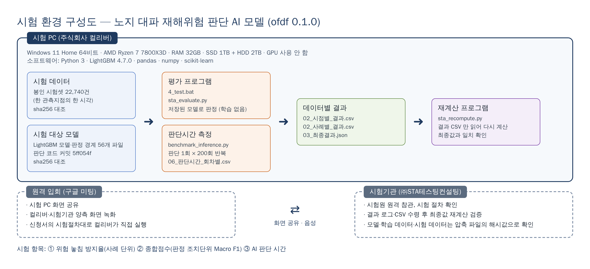

# 회신서 ① — 노지 대파 재해위험 판단 AI 모델 (ofdf 0.1.0)

주식회사 컬리버 · 시험일 2026-11-19 · 지원사업: AI 지능형 농업(AI 노지)

`[기입]` 은 시험 PC에서 읽어 적을 버전 자리입니다.

> **시험 중 구두 설명의 정리** — 시험 중 구두로 설명드린 내용 가운데 일부 표현을 결과 파일 기준으로 정리해 드립니다. 학습 데이터는 72,435건이며, 화면에 보인 4,281건은 원천자료 중 AgERA5 일자료의 건수입니다. 종합점수는 판정 항목마다 등급별 F1 을 평균한 Macro F1 이고, 10개 항목 각각이 0.80 이상인지로 판정합니다. 위험 놓침 방지율도 10개 항목 각각의 사례 단위 값이 0.85 이상인지로 판정합니다. 10개 항목 평균은 참고값으로 표 맨 아래에 함께 적었습니다. 판단 시간은 1회 평균 약 0.03초입니다.

## 1. 모델 · 학습 데이터 · 시험 데이터 해시값

해시 방식은 SHA-256 이며, 구분마다 한 폴더에 모아 압축한 파일 전체에 대해 추출했습니다.

| 구분 | 파일명 | SHA-256 | 내용 |
|---|---|---|---|
| 모델 | `model.zip` | `e0a6a9923567cdae783f6f079453932db9b7e8cb1b422d2b14024d13479a24ec` | LightGBM 모델·판정 경계 파일 56개 |
| 학습 데이터 | `data.zip` | `5e020c74630b831d1d4c1319dc631ee34f65683b745624717313ac6d0c47256f` | 원천자료(AAOS 월별 파일 120개, AgERA5 일자료)와 이를 가공한 데이터셋. 학습 72,435건·검증 14,025건은 이 자료에서 분할 씨앗 42 로 나뉜다 |
| 시험 데이터 | `01_시험데이터.zip` | `4639543410f55317851a5d7fbf6f69a435f608b7b61e8558d66ca92dc890de0d` | 시험셋.csv(22,740건), sha256.txt, 통계.txt |

## 2. 학습 · 시험 데이터 설명

| 항목 | 내용 |
|---|---|
| 원천자료 | 농업기상관측(AAOS) 나주 5개 지점 시간 자료 2016~2025년(월별 파일 120개), AgERA5 일자료(4,281건) |
| 전처리 | 시간 자료에 품질 검사를 하고, 일자료는 하루 전 값을 붙여 입력 변수 205개를 만든다 |
| 대상 구간 | 대파 작기 9~11월, 109,200건 (한 건 = 한 관측지점의 한 시각) |
| 정답 | 위험유형 5종의 등급(정상 0·주의 1·경계 2). 그 시각 뒤 1시간·3시간 안의 최고 등급 |
| 분할 | 기상사례 블록 130개 단위(위험 구간 앞뒤 12시간을 한 블록으로 묶음), 분할 씨앗 42 |
| **학습 데이터** | **72,435건** |
| 검증 데이터 | 14,025건 (학습 중단 시점과 판정 가중치 선택에 사용) |
| **시험 데이터** | **22,740건** (학습과 판정 경계 선택에 쓰지 않음) |
| 학습 보강 | 고온·건조, 병해 유리환경, 저온·서리의 3등급 모델은 작기 밖(9~11월 이외) 자료를 학습에만 추가. 검증·시험에는 쓰지 않음 |
| 파일 형식 | 원천자료: 월별 XLS · 일자료 CSV / 시험 데이터: CSV (UTF-8) — 시각, 관측지점, 입력 변수 205개, 판정 항목별 정답등급 |

## 3. 제품 개발 환경

세 시험 항목의 개발 환경은 같습니다.

| 항목 | 내용 |
|---|---|
| 알고리즘 | LightGBM(그래디언트 부스팅 결정트리) 다중분류. 위험유형 × 예측시계별 3등급 모델, 정상·위험 전용 모델의 5겹 교차검증 앙상블, 복합위험은 구성 위험 확률 점수로 판정 |
| 사용 언어 | Python `[기입]` |
| 개발 프레임워크 | LightGBM 4.7.0 · scikit-learn 1.9.1 · pandas 3.1.1 · NumPy 2.5.5 |

## 4. 서버·PC 사양

신청서 내용과 동일합니다.

| 항목 | 내용 |
|---|---|
| OS | Windows 11 Home 64비트 (10.0.26200) |
| CPU | AMD Ryzen 7 7800X3D (8코어 16스레드) |
| RAM | 32GB |
| 저장장치 | SSD 1TB, HDD 2TB |
| GPU | 사용 안 함 (시험은 CPU 로 실행) |

## 5. 시험 환경 구성도

## 6. 시험 항목별 결과와 산식

실행 파일 `4_test.bat` 하나로 세 항목이 함께 산출됩니다. 판정 항목은 위험유형 5종 × 예측시계 1·3시간 = 10개입니다.

| 시험 항목 | 기준 | 산식 | 결과 |
|---|---|---|---|
| 1. 위험 놓침 방지율 (사례 단위) | 10개 항목 각각 0.85 이상 | 탐지한 사례 수 ÷ 사례 수 | 10개 항목 모두 0.85 이상. 최저 0.889 (복합위험 1·3시간) |
| 2. 종합점수 (판정 조치단위 Macro F1) | 10개 항목 각각 0.80 이상 | 등급별 F1 의 단순 평균. F1 = 2·TP ÷ (2·TP + FP + FN) | 10개 항목 모두 0.80 이상. 최저 0.823 (고온·건조 3시간) |
| 3. AI 판단 시간 | 판단 1회 평균 30초 이내 | 끝에서 끝까지(ms) 200개 값의 합 ÷ 200 | 평균 29.99 ms (약 0.03초). 중앙값 29.78 ms · p95 30.71 ms · 최대 54.89 ms |

- 사례: `02_시점별_결과.csv` 에서 `위험사례ID` 가 같은 줄의 묶음. 그 안에 예측등급 1 이상이 한 번이라도 있으면 탐지.
- 평가단위: 주의·경계의 조치가 다른 유형(고온·건조, 병해 유리환경)은 3등급, 같은 유형(강우·과습, 저온·서리, 복합위험)은 정상·위험 2등급.
- 같은 입력 한 건으로 200회 반복 측정. 「끝에서 끝까지」는 피처 생성 + 3시간 모델 19개 추론 + 판단근거 추출 + 조치 결정을 한 번에 잰 값이며, 1시간 모델 19개 추론과 이력 기록은 들어 있지 않다(2026-11-22 정정). 단계별 열은 각각 따로 200회 잰 값이다. 시험 데이터 전체에 대한 재측정을 협의 중이다.
- 시간 단위 재현율 = (정답등급 1 이상이고 예측등급 1 이상인 줄 수) ÷ (정답등급 1 이상인 줄 수). 판정 기준이 아닌 참고값.

**항목별 값** (제출한 `02_시점별_결과.csv` · `02_사례별_결과.csv` 로 계산한 값)

| 판정 항목 | 평가단위 | 위험 표본 | 사례 수 | 탐지 | 놓침 방지율(사례 단위) | 종합점수(Macro F1) | 시간 단위 재현율(참고) |
|---|---|---|---|---|---|---|---|
| 고온·건조 1시간 | 3등급 | 3,424 | 316 | 305 | 0.965 | 0.911 | 0.968 |
| 고온·건조 3시간 | 3등급 | 4,081 | 316 | 310 | 0.981 | 0.823 | 0.962 |
| 강우·과습 1시간 | 2등급 | 94 | 21 | 20 | 0.952 | 0.911 | 0.766 |
| 강우·과습 3시간 | 2등급 | 136 | 21 | 20 | 0.952 | 0.861 | 0.618 |
| 병해 유리환경 1시간 | 3등급 | 3,508 | 447 | 401 | 0.897 | 0.937 | 0.967 |
| 병해 유리환경 3시간 | 3등급 | 4,419 | 447 | 409 | 0.915 | 0.911 | 0.962 |
| 저온·서리 1시간 | 2등급 | 1,612 | 169 | 167 | 0.988 | 0.957 | 0.924 |
| 저온·서리 3시간 | 2등급 | 2,070 | 169 | 167 | 0.988 | 0.940 | 0.884 |
| 복합위험 1시간 | 2등급 | 67 | 18 | 16 | 0.889 | 0.890 | 0.851 |
| 복합위험 3시간 | 2등급 | 103 | 18 | 16 | 0.889 | 0.848 | 0.602 |
| (참고) 10개 항목 평균 | | | | | 0.942 | 0.899 | |

시험 데이터는 항목마다 22,740건으로 같습니다. 시간 단위 재현율이 0.85 이상인 항목은 7개입니다.

## 7. 시험 결과 증적 (함께 보내는 파일)

| 파일 | 내용 |
|---|---|
| 화면 녹화 파일 | 시험 진행 전체 |
| `testday_20261119.zip` | 00_시험대상_해시 · 01_시험데이터 · 02_시점별_결과.csv · 02_사례별_결과.csv · 03_최종결과.json · 04_재계산_결과.txt · 05_실행로그.txt · 06_판단시간_회차별.csv |
