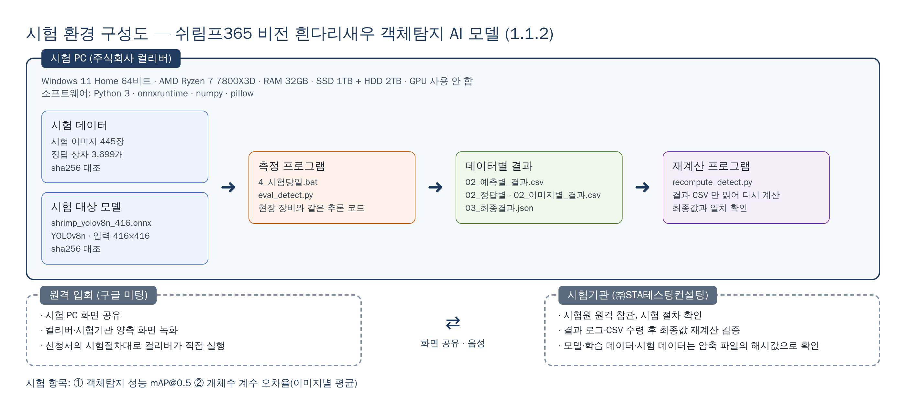

# 회신서 ② — 쉬림프365 비전 흰다리새우 객체탐지 AI 모델 (1.1.2)

주식회사 컬리버 · 시험일 2026-11-19 · 지원사업: 해양수산부 블루스타트업

`[값]` 과 `[붙여넣기]` 는 시험 PC에서 옮겨 적는 자리입니다.

> **시험 중 구두 설명의 정리** — 화면에 보인 13,211개는 모델이 낸 예측 상자 수이고, 시험 이미지 445장의 정답 상자는 3,699개입니다. mAP@0.5 는 이미지별 값의 평균이 아니라 전체 예측을 신뢰도 순으로 세워 계산한 값입니다.

## 1. 모델 · 학습 데이터 · 시험 데이터 해시값

구분마다 한 폴더에 모아 압축한 뒤 압축 파일의 SHA-256 을 적습니다. (`certutil -hashfile <파일명> SHA256`)

| 구분 | 파일명 | SHA-256 | 내용 |
|---|---|---|---|
| 모델 | `[붙여넣기]` | `[붙여넣기]` | `shrimp_yolov8n_416.onnx`, 측정 프로그램, 실행 파일 |
| 학습 데이터 | `[붙여넣기]` | `[붙여넣기]` | 학습 이미지 3,927장과 라벨, 검증 이미지 873장과 라벨 |
| 시험 데이터 | `[붙여넣기]` | `[붙여넣기]` | 시험 이미지 445장과 라벨 |

참고: 모델 파일 자체의 sha256 은 `ae95071c7e53df7e828e0faf51a54e0f7c5bb3010312b1d305949af12d533804` 입니다.

## 2. 학습 · 시험 데이터 설명

| 항목 | 내용 |
|---|---|
| 원천자료 | 공개 새우 이미지 데이터셋 2종 — shrimp_cf(성장한 새우) 5,032장, Counting PL(어린 새우) 213장. 합계 5,245장 |
| 정답 | 이미지마다 새우 위치 상자. 클래스는 `shrimp` 하나(성체와 자어를 합침). 원본 라벨의 폴리곤은 외접 상자로 바꿔 쓴다 |
| 분할 | 원본 프레임 단위로 다시 나눔(씨앗 20260101). 같은 원본에서 나온 증강 사본은 한 분할에만 들어간다 |
| **학습 데이터** | **3,927장** (어린 새우 161 + 성장한 새우 3,766) |
| 검증 데이터 | 873장 |
| **시험 데이터** | **445장** (어린 새우 21 + 성장한 새우 424), 정답 상자 3,699개. 학습·검증에 쓰지 않음 |
| 파일 형식 | 이미지 JPG, 라벨 YOLO 형식 TXT(이미지와 같은 파일명) |

## 3. 제품 개발 환경

두 시험 항목의 개발 환경은 같습니다.

| 항목 | 내용 |
|---|---|
| 알고리즘 | YOLOv8n 객체탐지 파인튜닝(단일 클래스). 탐지한 상자 수로 개체수를 센다 |
| 사용 언어 | Python `[값]` |
| 학습 프레임워크 | Ultralytics YOLOv8 `[값]` (PyTorch `[값]`) — 640px, 60에포크 |
| 추론·시험 프레임워크 | ONNX Runtime `[값]` · NumPy `[값]` · Pillow `[값]` |
| 모델 형식 | ONNX (opset 12), 입력 1×3×416×416 |

## 4. 서버·PC 사양

신청서 내용과 동일합니다.

| 항목 | 내용 |
|---|---|
| OS | Windows 11 Home 64비트 (10.0.26200) |
| CPU | AMD Ryzen 7 7800X3D (8코어 16스레드) |
| RAM | 32GB |
| 저장장치 | SSD 1TB, HDD 2TB |
| GPU | 사용 안 함 (시험은 CPU 로 실행) |

## 5. 시험 환경 구성도

## 6. 시험 항목별 결과와 산식

| 시험 항목 | 기준 | 결과 |
|---|---|---|
| 1. 객체탐지 성능 mAP@0.5 | 0.75 이상 | **0.9307** |
| 2. 개체수 계수 오차율 (이미지별 평균) | 20% 이하 | `[값]` % (약 2.8%) |

| 값 | 산식 |
|---|---|
| IoU | 예측 상자와 정답 상자가 겹친 넓이 ÷ 두 상자를 합친 넓이 |
| 맞음(TP) | IoU 0.5 이상이고 그 정답이 다른 예측과 짝지어지지 않았을 때. 신뢰도가 높은 예측이 먼저 가져간다 |
| mAP@0.5 | 예측 13,211개를 신뢰도 순으로 세워 누적한다. 정밀도 = 누적 TP ÷ (누적 TP + 누적 FP), 재현율 = 누적 TP ÷ 3,699. 이 곡선을 재현율 0~1 의 101점에서 읽어 평균(COCO 방식). 클래스가 하나라 AP 와 같다 |
| 계수 오차율 | 이미지마다 \|검출 수 − 정답 수\| ÷ 정답 수(검출 수는 신뢰도 0.25 이상인 상자 수), 그 평균. 정답 0마리 이미지는 제외하고 헛검출 수를 따로 적는다 |
| Precision · Recall · F1 (참고) | 신뢰도 0.25 에서 TP ÷ (TP + FP), TP ÷ (TP + FN), 2PR ÷ (P + R) |

## 7. 시험 결과 증적 (함께 보내는 파일)

| 파일 | 내용 |
|---|---|
| 화면 녹화 파일 | 시험 진행 전체 |
| `sta_블루스타트업` 압축 | 00_시험대상_해시 · 01_시험데이터 · 02_예측별·정답별·이미지별_결과.csv · 03_최종결과.json · 04_재계산_결과.txt · 05_실행로그.txt |
