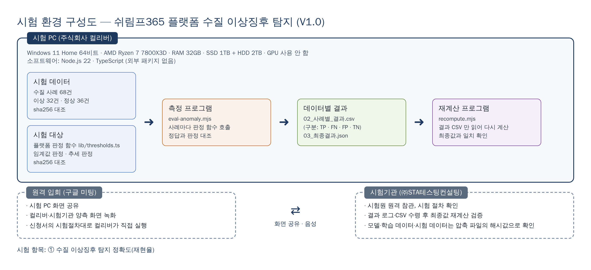

# 회신서 ③ — 쉬림프365 플랫폼 수질 이상징후 탐지 (V1.0)

주식회사 컬리버 · 시험일 2026-11-19 · 지원사업: AI·데이터 스타트업

`[기입]` 은 시험 PC에서 읽어 적을 버전 자리입니다.

> **시험 중 구두 설명의 정리** — 본 항목의 판정 기능은 양식 관리 기준값과 통계 규칙으로 동작하며, 가중치를 사전에 학습하는 방식이 아닙니다. 시험 시 학습 데이터로 말씀드린 자료는 시험 사례의 바탕이 된 원본 수질일지이며, 이를 압축해 해시값을 제출합니다.

## 1. 모델 · 학습 데이터 · 시험 데이터 해시값

해시 방식은 SHA-256 이며, 구분마다 한 폴더에 모아 압축한 파일 전체에 대해 추출했습니다.

| 구분 | 파일명 | SHA-256 | 내용 |
|---|---|---|---|
| 모델(판정 함수) | `lib.zip` | `2af7190fd57c2ff714e92d196e0390aec7762a0734c6cdc25505bc4f839efb55` | 플랫폼 판정 함수 `lib/thresholds.ts` 가 든 lib 폴더 |
| 원본 자료(학습 데이터 칸) | `학습데이터.zip` | `91adde66f6aa4f991bb0680b486cfca49ed86e8f9857a7469ceccbefdcf7610b` | 원본 수질일지 — 사전 학습에 쓴 자료가 아니라 시험 사례의 바탕이 된 자료 |
| 시험 데이터 | `01_시험데이터.zip` | `50c70f34b9b3be9641d7986c31fc9927b98417026bd7bbbe5b2eb7e3dd2f1a1e` | 사례 목록과 사례별 시계열 68건, 라벨 기준, 통계 |

참고: 판정 함수 파일의 sha256 은 `00093a844a8b22a63800031e6714a21ff201c06f966d4b2aecf3a8e9e16811bf` 입니다(기준 커밋 `a43d9c1`).

## 2. 학습 · 시험 데이터 설명

| 항목 | 내용 |
|---|---|
| 판정 방식 | 기준값·통계 규칙 기반. 사전 학습 없음 |
| 원본 자료 | 2024년 양식장 2곳, 수조 10개의 수기 수질일지. 항목은 수온 · pH · DO, 하루 2~4회 측정 |
| 시험 사례 | 한 수조의 약 7일 구간 시계열이 사례 1건. **모두 68건** |
| 정상 사례 | **36건** — 실측 기록, 또는 기준에 못 미치는 작은 변화만 넣은 기록 |
| 이상 사례 | **32건** — 실측 정상 기록에 라벨 기준표의 크기만큼 값을 넣은 모사 사례. 넣은 항목·시각·크기를 사례 파일에 적음 |
| 정답 기준 | 라벨 기준표 — 임계값 초과(DO 4.0 미만, pH 7.0 미만·8.5 초과), 급변, 연속 악화, 범위 이탈. 구간의 마지막 측정 시각에 관리자가 조치해야 하는 상태인지로 정함 |
| 파일 형식 | CSV (사례 목록과 사례별 시계열) |

실측 일지에는 기준을 벗어난 믿을 만한 기록이 없어 이상 사례는 모두 모사입니다. 이 결과는 모사 조건에서의 탐지 성능입니다.

## 3. 제품 개발 환경

| 항목 | 내용 |
|---|---|
| 알고리즘 | ① 임계값 판정 — 측정값이 항목별 주의·위험 기준을 벗어났는지 비교. ② 추세 판정 — 직전 측정 대비 급변, 일별 극값의 연속 악화, 최근 기록의 평균·표준편차 대비 범위 이탈 |
| 사용 언어 | TypeScript `[기입]` |
| 실행 환경 | Node.js `[기입]` |
| 개발 프레임워크 | Next.js 16.2.4 · React 19.2.4 · Supabase(supabase-js `[기입]`) |

## 4. 서버·PC 사양

신청서 내용과 동일합니다.

| 항목 | 내용 |
|---|---|
| OS | Windows 11 Home 64비트 (10.0.26200) |
| CPU | AMD Ryzen 7 7800X3D (8코어 16스레드) |
| RAM | 32GB |
| 저장장치 | SSD 1TB, HDD 2TB |
| GPU | 사용 안 함 (시험은 CPU 로 실행) |

## 5. 시험 환경 구성도

## 6. 시험 항목 결과와 산식

사례마다 구간의 시계열을 판정 함수에 넣어, 주의 또는 위험 결과가 하나라도 나오면 「이상」, 아니면 「정상」으로 판정합니다. 판정 시점은 구간의 마지막 측정 시각입니다.

| 실제 | 이상 판정 | 정상 판정 | 합계 |
|---|---|---|---|
| 이상 | TP 30 | FN 2 | 32 |
| 정상 | FP 10 | TN 26 | 36 |
| 합계 | 40 | 28 | 68 |

| 값 | 산식 | 결과 |
|---|---|---|
| **재현율 (시험 항목, 기준 0.9 이상)** | TP ÷ (TP + FN) = 30 ÷ 32 | **0.9375** |
| 정밀도 (참고) | TP ÷ (TP + FP) = 30 ÷ 40 | 0.7500 |
| F1 (참고) | 2·TP ÷ (2·TP + FP + FN) = 60 ÷ 72 | 0.8333 |
| 정확도 (참고) | (TP + TN) ÷ 전체 = 56 ÷ 68 | 0.8235 |
| 오경보율 (참고) | FP ÷ (FP + TN) = 10 ÷ 36 | 0.2778 |

구분: TP 정답 이상·판정 이상 / FN 정답 이상·판정 정상 / FP 정답 정상·판정 이상 / TN 정답 정상·판정 정상. `02_사례별_결과.csv` 의 「구분」 열을 세면 위 값이 나옵니다.

## 7. 시험 결과 증적 (함께 보내는 파일)

| 파일 | 내용 |
|---|---|
| 화면 녹화 파일 | 시험 진행 전체 |
| `sta_AI데이터` 압축 | 00_시험대상_해시 · 01_시험데이터 · 02_사례별_결과.csv · 03_최종결과.json · 04_재계산_결과.txt · 05_실행로그.txt |
